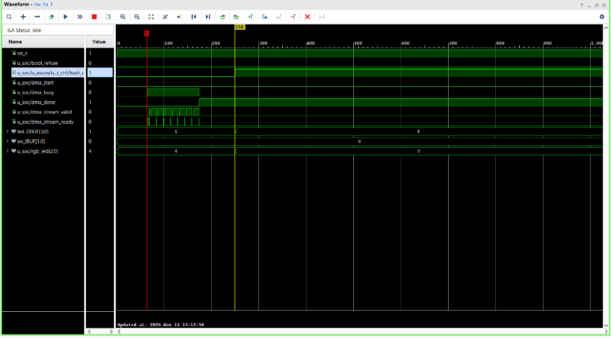
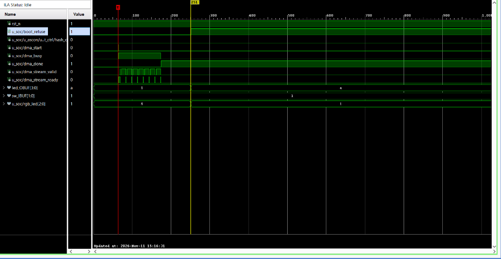
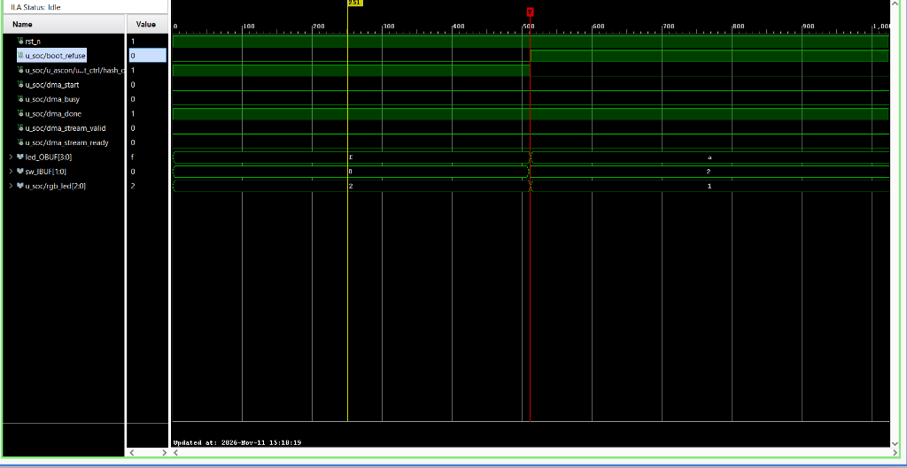
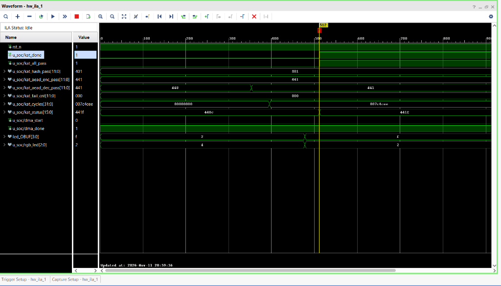

# Ascon Cryptographic Engine & RISC-V Secure Boot SoC

Hardware implementation of **Ascon-AEAD128** and **Ascon-Hash256** per **NIST SP 800-232 (Final, August 2025)**, integrated with a RISC-V PicoRV32 processor on the Digilent Zybo Z7-10 FPGA for cryptographically-verified secure boot.

[-green.svg)](https://csrc.nist.gov/pubs/sp/800/232/final)
[](board/zybo_z7_10.xdc)
[]()
[-brightgreen.svg)](results/board/HARDWARE_RUNBOOK.md)
[](results/board/ila_traces/ila_onboard_kat_all2114.png)

---

## Key Highlights

- **Standard Compliance**: Implements Ascon-AEAD128 and Ascon-Hash256 strictly according to NIST SP 800-232 (August 2025).
- **Silicon Proven**: Verified on AMD-Xilinx Zynq-7000 (XC7Z010) silicon at 100 MHz with live Vivado Integrated Logic Analyzer (ILA) captures.
- **Architectural Exploration**: 5 permutation architectures (1-round iterative, 2-round unrolled, half-round folded, 32-bit slice-serial, Espresso SOP) and 4 S-box implementations (canonical, Espresso, factored kernels, BDD).
- **Hardware Security Gates**:
  - Autonomous DMA engine with hardware 256-bit digest comparator.
  - Hardware Instruction Fetch Guard intercepting unauthorized code fetches.
  - Sticky physical tamper latch (`tamper_det`) with persistent lockout.
  - Side-channel plaintext release gate suppressing unauthenticated data.
- **Zero-Warning Vivado Projects**: Two clean, portable projects (`ascon_boot.xpr` and `ascon_kat.xpr`) using relative paths.

---

## Hardware Verification on Zybo Z7-10 (Live ILA Captures)

All waveforms below were captured directly from the physical Digilent Zybo Z7-10 FPGA using Vivado ILA (`xilinx.com:ip:ila:6.2`) sampled at 100 MHz.

### 1. Normal Authentic Boot (Green LED, 186-Cycle Verification)
*Stimulus: `SW0=0`, `SW1=0`, reset via `BTN0`.*  
The DMA streams candidate firmware to Ascon-Hash256. At cycle 186 after `dma_start` (1.86 $\mu\text{s}$), the 256-bit reference digest matches, asserting `hash_ok = 1` and `boot_jump_enable = 1`. Discrete LEDs switch from `0x1` to `0xF` (`4'b1111`) and RGB LED `LD6` turns solid green (`0x2`).



### 2. Live Byte-Flip Fault Injection Refusal (Red LED)
*Stimulus: `SW0=1` (inverts bit 0 of payload word `0x410` during DMA streaming).*  
Ascon-Hash256 computes the digest over the corrupted payload. The digest comparator detects the mismatch; `hash_ok` remains `0` and `boot_refuse` asserts (`0 -> 1`). Discrete LEDs latch to `0xA` (`4'b1010`) and RGB LED `LD6` glows solid red (`0x1`). The CPU is permanently held in refusal state.



### 3. Runtime Physical Tamper Sensor Lockout
*Stimulus: System booted green, then `SW1` flipped `0 -> 1`.*  
The physical tamper sensor immediately sets `tamper_latched = 1`, driving `boot_refuse = 1`, clearing `hash_ok`, and switching the RGB LED from green to solid red (`4'b1010`). Flipping `SW1` back to 0 does not clear the refusal: the hardware requires a power-on or button reset (`BTN0`).



### 4. Full On-Board NIST KAT Execution (2,114 Test Vectors)
*Stimulus: Standalone KAT SoC running bare-metal on Zybo Z7-10.*  
Executes all 1,025 Hash vectors (0 to 1,024 bytes) and all 1,089 AEAD Encrypt/Decrypt vectors.
- `kat_hash_pass` = `0x401` (1,025 passed)
- `kat_aead_enc_pass` = `0x441` (1,089 passed)
- `kat_aead_dec_pass` = `0x441` (1,089 passed)
- `kat_fail_cnt` = `0x000` (0 failures across 3,204 checks)
- Total execution time = 81.46 ms (8,146,158 cycles @ 100 MHz)
- Final status = `0x441f` with solid green RGB LED.



---

## Performance & Implementation Results

All figures below are taken from post-implementation routed reports targeting the AMD-Xilinx Zynq-7000 XC7Z010-1CLG400C at 100 MHz (Vivado 2025.1).

### Permutation Architectures (Out-of-Context Placement & Routing)

| Architecture Variant | Top Module | Slice LUTs | Slice FFs | BRAM | DSP | WNS @ 100MHz | $F_{max}$ (MHz) | AEAD Throughput @ $F_{max}$ |
| :--- | :--- | :---: | :---: | :---: | :---: | :---: | :---: | :---: |
| **1-Round Iterative (Baseline)** | `permutation_1r` | 544 | 335 | 0 | 0 | +5.154 ns | **206.36** | 3.30 Gbps |
| **2-Round Unrolled (High Throughput)** | `permutation_2r` | 939 | 335 | 0 | 0 | +2.639 ns | **135.85** | **4.35 Gbps** |
| **Half-Round Folded (High Frequency)** | `permutation_half` | 546 | 655 | 0 | 0 | +6.225 ns | **264.90** | 2.12 Gbps |
| **32-Bit Serialised (Exploratory)** | `permutation_serial32` | 722 | 497 | 0 | 0 | +3.506 ns | **153.99** | 1.23 Gbps |
| **1-Round Espresso (SOP Minimized)** | `permutation_1r_espresso` | 605 | 335 | 0 | 0 | +3.654 ns | **157.58** | 2.52 Gbps |
| **Full Secure Boot SoC** | `top_bringup_board` | **5,088** | **5,486** | **4** | **0** | **+1.510 ns** | **117.79** | — |

*Detailed analysis: [results/performance/comparison_table.md](results/performance/comparison_table.md).*

### Power Consumption (Post-Route `report_power` on Zybo Z7-10 @ 100 MHz)

| Configuration | Total Chip Power | Dynamic Power | Static Power | Junction Temperature | Report File |
| :--- | :---: | :---: | :---: | :---: | :--- |
| **Secure Boot SoC (`top_bringup_board`)** | **277 mW** | 185 mW | 92 mW | 28.2 °C | [power_bringup_routed.rpt](results/performance/power_bringup_routed.rpt) |
| **NIST KAT Runner SoC (`top_kat_board`)** | **365 mW** | 267 mW | 98 mW | 29.2 °C | [power_kat_routed.rpt](results/performance/power_kat_routed.rpt) |

---

## Vivado Projects

The repository includes two self-contained Vivado projects configured with relative paths:

### 1. `vivado/ascon_boot/ascon_boot.xpr` (Secure Boot SoC)
- **Synthesis Top**: `top_bringup_board`
- **Simulation Set**: Includes pre-configured `.wcfg` waveform layouts with clean ASCII string banners and binary LED radices:
  - `tb_demo_04_secure_boot.sv`: 3-scenario live presentation demo (Scenario A: Normal boot, Scenario B: SW0 byte-flip, Scenario C: SW1 tamper).
  - `tb_secure_boot.sv`: 9-case regression matrix (tampered payload, invalid length, bad magic, DMA fault, reset mid-verification, repeated refusal).
  - `tb_demo_01_sbox_and_perm.sv`: Parallel comparison of 1R, 2R, Half, and Serial32 permutation cores.
  - `tb_demo_02_hash_digest.sv`: Hash-256 NIST test vectors and 1-bit avalanche effect.
  - `tb_demo_03_aead_and_gate.sv`: AEAD128 encryption/decryption with plaintext release gate.
  - `tb_demo_05_fetch_guard.sv`: Instruction fetch guard security proof.

### 2. `vivado/ascon_kat/ascon_kat.xpr` (NIST KAT Runner)
- **Synthesis Top**: `top_kat_board`
- **Simulation Set**: `tb_kat_soc.sv` (60 preflight NIST vectors verifying 100% pass before hardware run).

---

## Quick Start & Verification

### Run All Simulations (Vivado Batch Mode)
To verify all 7 testbenches across both projects in one command:
```powershell
vivado -mode batch -source scripts/verify_all_sims.tcl -nolog -nojournal
```
Expected output:
```text
======================================================================
                FINAL SIMULATION VERIFICATION MATRIX                  
======================================================================
  tb_demo_04_secure_boot       : PASS   (40us)
  tb_secure_boot               : PASS   (30us)
  tb_demo_01_sbox_and_perm     : PASS   (2us)
  tb_demo_02_hash_digest       : PASS   (2us)
  tb_demo_03_aead_and_gate     : PASS   (2us)
  tb_demo_05_fetch_guard       : PASS   (10us)
  tb_kat_soc                   : PASS   (30ms)
======================================================================
TOTAL PASSED: 7 / 7 (100% PASS)
======================================================================
```

### Run Python Golden Model (KATs)
```bash
python reference/run_kats.py
# PASS: AEAD 1,089 + HASH 1,025 vectors (2,114 total) + 6 edge cases
```

### Synthesize Permutation Variants
```powershell
vivado -mode batch -source scripts/synth_variants.tcl
python scripts/parse_synth_reports.py
```

### Build FPGA Bitstream (Zybo Z7-10)
```powershell
vivado -mode batch -source scripts/build_bitstream.tcl
```

---

## Formal Safety Verification (NuSMV CTL)

Five CTL safety properties were formally proved on `formal/ctl/boot_safety_corrected.smv` using NuSMV 2.6.0:

```
AG(jump -> hash_ok)                  — PROVED (No execution without authentic hash)
AG(jump -> verified_before_jump)     — PROVED (Verification strictly precedes jump)
AG(tamper_latched -> !EF jump)       — PROVED (Tamper prevents any future boot)
AG(DECIDE & !hash_ok -> AX REFUSE)   — PROVED (Hash mismatch deterministically refuses)
AG(refuse -> AG refuse)              — PROVED (Refusal state is sticky and terminal)
```
Proof log: [results/formal/nuxmv/proof_corrected_nusmv.log](results/formal/nuxmv/proof_corrected_nusmv.log).

---

## Board Physical Mapping (Zybo Z7-10)

| Interface Element | Pin | Semantic | Behavior |
| :--- | :---: | :--- | :--- |
| **Clock (125 MHz)** | `K17` | Ethernet PHY oscillator | MMCM synthesizes 100 MHz system clock |
| **Button 0 (`BTN0`)** | `K18` | System Reset | Active-High manual reset button |
| **Switch 0 (`SW0`)** | `G15` | Fault Injection | When `1`, inverts bit 0 of payload word `0x410` during DMA stream |
| **Switch 1 (`SW1`)** | `P15` | Tamper Sensor | When `1`, triggers physical tamper lockout |
| **Discrete LEDs (`LD0..LD3`)** | `M14..D18` | Status Pattern | `4'b1111` = Boot Pass, `4'b1010` = Refusal |
| **RGB LED (`LD6`)** | `V16, F17, M17` | Security Indicator | **Blue**: Hashing, **Green**: Boot Granted, **Red**: Refusal Lockout |

*Hardware execution guide: [results/board/HARDWARE_RUNBOOK.md](results/board/HARDWARE_RUNBOOK.md).*

---

## Repository Structure

```
├── rtl/
│   ├── ascon/         Cryptographic cores (permutations, S-boxes, mode controllers, security gate)
│   ├── soc/           PicoRV32 SoC, boot_ctrl FSM, fetch_guard, top bringup wrappers
│   ├── bus/           AXI4-Lite register file (axil_regs.sv)
│   └── dma/           AXI-Lite autonomous streaming DMA (dma_master.sv)
├── tb/
│   ├── demo/          Interactive demo testbenches (tb_demo_01 to 05)
│   ├── integration/   SoC integration testbenches (tb_secure_boot.sv 9-case matrix)
│   └── unit/          Unit testbenches (1r, 2r, half, serial32, sbox equivalence)
├── board/             Constraints (zybo_z7_10.xdc) and KAT hardware runner
├── firmware/          Secure bootloader ROM C code and test payload hex files
├── formal/            NuSMV CTL models and SVA assertions
├── reference/         Python golden model and official NIST KAT vector files
├── scripts/           Batch simulation, synthesis, bitstream, and link verification scripts
├── vivado/            ascon_boot.xpr and ascon_kat.xpr projects with waveform configs
└── results/           Committed post-route synthesis reports, timing reports, and ILA traces
```

---

## References

- [NIST SP 800-232](https://csrc.nist.gov/pubs/sp/800/232/final) — Ascon Lightweight Cryptography Standard (August 2025)
- [Ascon Reference C Implementation](https://github.com/ascon/ascon-c)
- [PicoRV32 RISC-V Core](https://github.com/YosysHQ/picorv32)
- [Groß et al. 2015](https://eprint.iacr.org/2015/034.pdf) — Ascon hardware implementations
