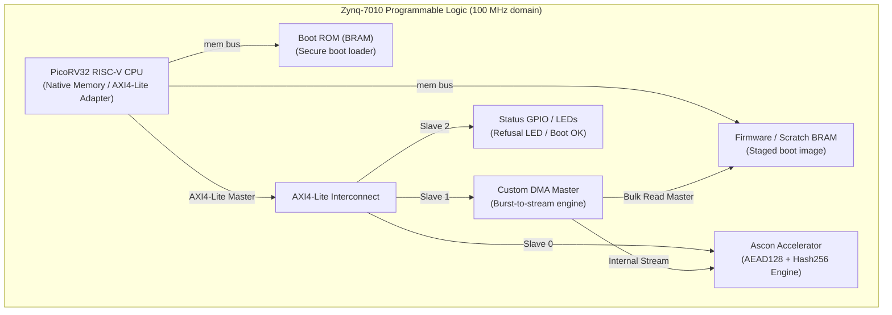

# Architecture Specification: Ascon AEAD and Hash Engine for IoT Secure Boot

- **Standard:** NIST SP 800-232 (Final, August 2025)
- **Reference Repository:** [`ascon/ascon-c`](https://github.com/ascon/ascon-c)
- **Target Device:** Digilent Zybo Z7-10 (AMD-Xilinx XC7Z010-1CLG400C)
- **Target Frequency:** 100 MHz
- **Status:** `[ACTIVE — Algorithm Specification Verified Against Reference]`

---

## 1. Executive Summary & Normative References

`[SPEC]` This project implements an authenticated-encryption and hash coprocessor supporting **Ascon-AEAD128** and **Ascon-Hash256** per **NIST SP 800-232**. The core accelerates cryptographic operations for an on-chip RV32 RISC-V SoC (PicoRV32) on the Digilent Zybo Z7-10 to implement hardware-enforced secure boot.

### Normative Citations
- `[SOURCE]` **NIST SP 800-232**, *"Ascon-Based Lightweight Cryptography Standards for Constrained Devices: Authenticated Encryption, Hash, and Extendable Output Functions"*, NIST Special Publication 800-232, DOI: `10.6028/NIST.SP.800-232`.
- `[SOURCE]` **Official C Reference Repository:** `https://github.com/ascon/ascon-c` (SP 800-232 compliant, little-endian implementation).
- `[SOURCE]` **Official Python Reference:** `https://github.com/meichlseder/pyascon`.
- `[SOURCE]` **Official Known Answer Tests:** `reference/ascon-c/crypto_aead/asconaead128/LWC_AEAD_KAT_128_128.txt` and `reference/ascon-c/crypto_hash/asconhash256/LWC_HASH_KAT_128_256.txt`.

---

## 2. Ascon State Representation & Endianness

### 2.1 320-Bit Internal State
The Ascon permutation operates on an internal state $S$ of 320 bits, divided into five 64-bit words:
$$S = (S_0, S_1, S_2, S_3, S_4)$$

```
+-----------------------------------------------------------+
| Word S0 [63:0] : Rate (AEAD / Hash)                       |
+-----------------------------------------------------------+
| Word S1 [63:0] : Rate (AEAD) / Capacity (Hash)            |
+-----------------------------------------------------------+
| Word S2 [63:0] : Capacity (Round constant c_i added here) |
+-----------------------------------------------------------+
| Word S3 [63:0] : Capacity (Key/Tag output)                |
+-----------------------------------------------------------+
| Word S4 [63:0] : Capacity (Key/Tag output / Domain sep)   |
+-----------------------------------------------------------+
```

### 2.2 Little-Endian Byte Mapping (SP 800-232 Convention)
`[SOURCE]` In contrast to pre-2025 Ascon v1.2, **NIST SP 800-232 mandates little-endian byte ordering**:
- A byte array $B = (b_0, b_1, \dots, b_7)$ maps into a 64-bit word $W$ such that byte $b_0$ is the **least significant byte (LSB)**:
  $$W = \sum_{j=0}^{7} b_j \cdot 2^{8j}$$
- In SystemVerilog bit notation:
  - $W[7:0] = b_0$
  - $W[15:8] = b_1$
  - $W[23:16] = b_2$
  - $W[31:24] = b_3$
  - $W[39:32] = b_4$
  - $W[47:40] = b_5$
  - $W[55:48] = b_6$
  - $W[63:56] = b_7$
- Reference C confirmation (`reference/ascon-c/crypto_aead/asconaead128/ref/word.h`):
  ```c
  #define GETBYTE(x, i) ((uint8_t)((uint64_t)(x) >> (8 * (i))))
  #define SETBYTE(b, i) ((uint64_t)(b) << (8 * (i)))
  ```

---

## 3. Permutation Round Function: $p = p_L \circ p_S \circ p_C$

The 320-bit permutation $p$ iteratively transforms the state through three successive layers:
1. **$p_C$:** Constant Addition Layer
2. **$p_S$:** Non-linear Substitution Layer (5×5 S-box)
3. **$p_L$:** Linear Diffusion Layer

```
Input State S
      │
      ▼
┌──────────────┐
│  p_C Layer   │  S2 ^= round_constant[round_index]
└──────┬───────┘
      │
      ▼
┌──────────────┐
│  p_S Layer   │  64 vertical 5-bit S-boxes across (S0..S4)
└──────┬───────┘
      │
      ▼
┌──────────────┐
│  p_L Layer   │  Bitwise word rotations and XOR diffusions
└──────┬───────┘
      │
      ▼
Output State S'
```

### 3.1 Constant Addition Layer ($p_C$)
In round $i$, an 8-bit round constant $c_i$ is XORed directly into the least significant byte of state word $S_2$:
$$S_2 \leftarrow S_2 \oplus c_i$$

For a permutation of $R$ rounds ($R \in \{6, 8, 12\}$), round $i$ ($0 \le i < R$) uses constant $\text{const}_{16 - R + i}$ from the NIST SP 800-232 base table:

| Base Index | Constant (Hex) | $R=12$ Round | $R=8$ Round | $R=6$ Round |
|:---:|:---:|:---:|:---:|:---:|
| 0 | `0x3c` | — | — | — |
| 1 | `0x2d` | — | — | — |
| 2 | `0x1e` | — | — | — |
| 3 | `0x0f` | — | — | — |
| 4 | `0xf0` | Round 0 | — | — |
| 5 | `0xe1` | Round 1 | — | — |
| 6 | `0xd2` | Round 2 | — | — |
| 7 | `0xc3` | Round 3 | — | — |
| 8 | `0xb4` | Round 4 | Round 0 | — |
| 9 | `0xa5` | Round 5 | Round 1 | — |
| 10 | `0x96` | Round 6 | Round 2 | Round 0 |
| 11 | `0x87` | Round 7 | Round 3 | Round 1 |
| 12 | `0x78` | Round 8 | Round 4 | Round 2 |
| 13 | `0x69` | Round 9 | Round 5 | Round 3 |
| 14 | `0x5a` | Round 10 | Round 6 | Round 4 |
| 15 | `0x4b` | Round 11 | Round 7 | Round 5 |

### 3.2 Non-linear Substitution Layer ($p_S$)
`[SOURCE]` The substitution layer applies a 5-bit non-linear S-box to each of the 64 bit-slices across words $S_0, S_1, S_2, S_3, S_4$.
For each column bit $j \in [0, 63]$:
$$(x_0, x_1, x_2, x_3, x_4) = (S_{0}[j], S_{1}[j], S_{2}[j], S_{3}[j], S_{4}[j])$$
$$(y_0, y_1, y_2, y_3, y_4) = \text{SBOX}(x_0, x_1, x_2, x_3, x_4)$$

#### Normative S-Box Truth Table (NIST SP 800-232 Table 6)
Input index $x = (x_0 \cdot 16 + x_1 \cdot 8 + x_2 \cdot 4 + x_3 \cdot 2 + x_4)$:

| Input (Hex) | Binary $(x_0 x_1 x_2 x_3 x_4)$ | Output (Hex) | Binary $(y_0 y_1 y_2 y_3 y_4)$ |
|:---:|:---:|:---:|:---:|
| `0x00` | `00000` | `0x04` | `00100` |
| `0x01` | `00001` | `0x0b` | `01011` |
| `0x02` | `00010` | `0x1f` | `11111` |
| `0x03` | `00011` | `0x14` | `10100` |
| `0x04` | `00100` | `0x1a` | `11010` |
| `0x05` | `00101` | `0x15` | `10101` |
| `0x06` | `00110` | `0x09` | `01001` |
| `0x07` | `00111` | `0x02` | `00010` |
| `0x08` | `01000` | `0x1b` | `11011` |
| `0x09` | `01001` | `0x05` | `00101` |
| `0x0a` | `01010` | `0x08` | `01000` |
| `0x0b` | `01011` | `0x12` | `10010` |
| `0x0c` | `01100` | `0x1d` | `11101` |
| `0x0d` | `01101` | `0x03` | `00011` |
| `0x0e` | `01110` | `0x06` | `00110` |
| `0x0f` | `01111` | `0x1c` | `11100` |
| `0x10` | `10000` | `0x1e` | `11110` |
| `0x11` | `10001` | `0x13` | `10011` |
| `0x12` | `10010` | `0x07` | `00111` |
| `0x13` | `10011` | `0x0e` | `01110` |
| `0x14` | `10100` | `0x00` | `00000` |
| `0x15` | `10101` | `0x0d` | `01101` |
| `0x16` | `10110` | `0x11` | `10001` |
| `0x17` | `10111` | `0x18` | `11000` |
| `0x18` | `11000` | `0x10` | `10000` |
| `0x19` | `11001` | `0x0c` | `01100` |
| `0x1a` | `11010` | `0x01` | `00001` |
| `0x1b` | `11011` | `0x19` | `11001` |
| `0x1c` | `11100` | `0x16` | `10110` |
| `0x1d` | `11101` | `0x0a` | `01010` |
| `0x1e` | `11110` | `0x0f` | `01111` |
| `0x1f` | `11111` | `0x17` | `10111` |

#### Bit-Slice Boolean Equations (Keccak $\chi$ Equivalence)
The Ascon S-box can be decomposed into an affine input transformation, non-linear Keccak $\chi$ mapping (multiplicative complexity 5, algebraic degree 2), and an affine output transformation:

```verilog
// 1. Affine input transformation
logic [63:0] s0, s1, s2, s3, s4;
always_comb begin
  s0 = S0 ^ S4;
  s4 = S4 ^ S3;
  s2 = S2 ^ S1;
  s1 = S1;
  s3 = S3;

  // 2. Keccak chi non-linear layer
  t0 = s0 ^ (~s1 & s2);
  t1 = s1 ^ (~s2 & s3);
  t2 = s2 ^ (~s3 & s4);
  t3 = s3 ^ (~s4 & s0);
  t4 = s4 ^ (~s0 & s1);

  // 3. Affine output transformation
  y1 = t1 ^ t0;
  y0 = t0 ^ t4;
  y3 = t3 ^ t2;
  y2 = ~t2;
  y4 = t4;
end
```
> **Security & Area Note:** Because Ascon sponge modes (AEAD encryption, decryption, hash) only ever evaluate the permutation in the **forward direction**, the inverse S-box is **never synthesized in hardware**, saving substantial silicon area.

### 3.3 Linear Diffusion Layer ($p_L$)
The linear layer provides horizontal intra-word diffusion using bitwise XOR and circular right rotations:
$$S_0 \leftarrow \Sigma_0(T_0) = T_0 \oplus (T_0 \ggg 19) \oplus (T_0 \ggg 28)$$
$$S_1 \leftarrow \Sigma_1(T_1) = T_1 \oplus (T_1 \ggg 61) \oplus (T_1 \ggg 39)$$
$$S_2 \leftarrow \Sigma_2(T_2) = T_2 \oplus (T_2 \ggg 1) \oplus (T_2 \ggg 6)$$
$$S_3 \leftarrow \Sigma_3(T_3) = T_3 \oplus (T_3 \ggg 10) \oplus (T_3 \ggg 17)$$
$$S_4 \leftarrow \Sigma_4(T_4) = T_4 \oplus (T_4 \ggg 7) \oplus (T_4 \ggg 41)$$

In hardware (SystemVerilog), circular right shifts are zero-cost wiring permutations:
```verilog
function automatic [63:0] ror(input [63:0] x, input int unsigned n);
  return (x >> n) | (x << (64 - n));
endfunction

assign S0_out = T0 ^ ror(T0, 19) ^ ror(T0, 28);
assign S1_out = T1 ^ ror(T1, 61) ^ ror(T1, 39);
assign S2_out = T2 ^ ror(T2,  1) ^ ror(T2,  6);
assign S3_out = T3 ^ ror(T3, 10) ^ ror(T3, 17);
assign S4_out = T4 ^ ror(T4,  7) ^ ror(T4, 41);
```

---

## 4. Ascon-AEAD128 Specification

### 4.1 Parameters
- **Key Length ($k$):** 128 bits ($K = K_0 \parallel K_1$)
- **Nonce Length ($n$):** 128 bits ($N = N_0 \parallel N_1$)
- **Tag Length ($t$):** 128 bits ($T = T_0 \parallel T_1$)
- **Rate ($r$):** 128 bits (16 bytes = 2 words: $S_0, S_1$)
- **Capacity ($c$):** 192 bits (3 words: $S_2, S_3, S_4$)
- **Rounds:** Initialization $a=12$, Processing $b=8$, Finalization $a=12$
- **Initialization Vector:**
  $$\text{IV}_{\text{AEAD}} = \text{0x00001000808c0001}$$

### 4.2 Initialization
1. Load initial state:
   $$S \leftarrow (\text{IV}_{\text{AEAD}} \parallel K_0 \parallel K_1 \parallel N_0 \parallel N_1)$$
2. Execute 12-round permutation: $S \leftarrow p^{12}(S)$
3. Key XOR:
   $$S_3 \leftarrow S_3 \oplus K_0$$
   $$S_4 \leftarrow S_4 \oplus K_1$$

### 4.3 Associated Data (AD) Processing
If associated data length $\text{adlen} > 0$:
1. For each full 16-byte block $A_i = (A_{i,0}, A_{i,1})$:
   $$S_0 \leftarrow S_0 \oplus A_{i,0}$$
   $$S_1 \leftarrow S_1 \oplus A_{i,1}$$
   $$S \leftarrow p^8(S)$$
2. For the final partial block (or if $\text{adlen}$ is a multiple of 16, a padding block):
   - Pad with byte `0x01` at index `rem = adlen % 16`:
     - If $\text{rem} < 8$: pad byte into $S_0$ at `rem`, $S_0 \leftarrow S_0 \oplus A_{\text{final},0} \oplus (0x01 \ll (8 \cdot \text{rem}))$
     - If $\text{rem} \ge 8$: absorb 8 bytes into $S_0$, pad into $S_1$ at `rem - 8`
   - Execute 8-round permutation: $S \leftarrow p^8(S)$
3. **Domain Separation:**
   XOR domain separation bit into the MSB of word $S_4$:
   $$S_4 \leftarrow S_4 \oplus \text{0x8000000000000000}$$

### 4.4 Plaintext Encryption / Ciphertext Decryption
For encryption of plaintext blocks $M_i = (M_{i,0}, M_{i,1})$:
1. Full blocks:
   $$C_{i,0} = S_0 \oplus M_{i,0}, \quad S_0 \leftarrow C_{i,0}$$
   $$C_{i,1} = S_1 \oplus M_{i,1}, \quad S_1 \leftarrow C_{i,1}$$
   $$S \leftarrow p^8(S)$$
2. Final block (length $\text{mlen}$):
   - Absorb available bytes, emit corresponding ciphertext bytes.
   - Apply padding: XOR byte `0x01` into state at index `mlen % 16`.
   - Do **not** execute permutation after final plaintext block.

### 4.5 Finalization & Tag Generation
1. Key XOR:
   $$S_2 \leftarrow S_2 \oplus K_0$$
   $$S_3 \leftarrow S_3 \oplus K_1$$
2. Execute 12-round permutation: $S \leftarrow p^{12}(S)$
3. Compute 128-bit authentication tag $T = (T_0, T_1)$:
   $$T_0 = S_3 \oplus K_0$$
   $$T_1 = S_4 \oplus K_1$$

### 4.6 Plaintext Release Security Gate
`[SPEC]` In decryption mode, ciphertext is decrypted into an internal **shadow buffer**. Decrypted plaintext is **never released** across AXI4-Lite or DMA until tag comparison verifies $T = T_{\text{received}}$ in constant time. If verification fails:
- Assert `tag_ok = 0` and `error = 1`.
- Immediately zeroize/clear the shadow buffer.
- Prevent external read access.

---

## 5. Ascon-Hash256 Specification

### 5.1 Parameters
- **Digest Length ($h$):** 256 bits (32 bytes = 4 words: $H_0, H_1, H_2, H_3$)
- **Rate ($r$):** 64 bits (8 bytes = 1 word: $S_0$)
- **Capacity ($c$):** 256 bits (4 words: $S_1, S_2, S_3, S_4$)
- **Rounds:** Initialization $a=12$, Absorb $b=12$, Squeeze $a=12$ (all rounds are 12!)
- **Initialization Vector:**
  $$\text{IV}_{\text{Hash}} = \text{0x0000080100cc0002}$$

### 5.2 Initialization
1. Load initial state:
   $$S \leftarrow (\text{IV}_{\text{Hash}} \parallel 0^{64} \parallel 0^{64} \parallel 0^{64} \parallel 0^{64})$$
2. Execute 12-round permutation: $S \leftarrow p^{12}(S)$

### 5.3 Message Absorption
1. For each full 8-byte message block $M_i$:
   $$S_0 \leftarrow S_0 \oplus M_i$$
   $$S \leftarrow p^{12}(S)$$
2. Final partial block (length $\text{mlen}$):
   - XOR available message bytes into $S_0$.
   - Pad with byte `0x01` at index `rem = mlen % 8`:
     $$S_0 \leftarrow S_0 \oplus (0x01 \ll (8 \cdot \text{rem}))$$
   - Execute 12-round permutation: $S \leftarrow p^{12}(S)$

### 5.4 Squeeze Phase (Digest Generation)
Extract 256 bits across 4 squeeze iterations:
1. $H_0 = S_0$; execute $S \leftarrow p^{12}(S)$
2. $H_1 = S_0$; execute $S \leftarrow p^{12}(S)$
3. $H_2 = S_0$; execute $S \leftarrow p^{12}(S)$
4. $H_3 = S_0$ (final digest word; no trailing permutation needed)

$$\text{Digest} = H_0 \parallel H_1 \parallel H_2 \parallel H_3$$

---

## 6. Official KAT Cross-Check Verification

Both AEAD and Hash implementations have been compiled and verified against the official NIST test suites in `reference/ascon-c`:

### 6.1 Ascon-Hash256 Empty Message Vector
- **Input:** $M = \emptyset$ (length = 0)
- **Computed Digest:**
  `0B3BE5850F2F6B98CAF29F8FDEA89B64A1FA70AA249B8F839BD53BAA304D92B2`
- **KAT Reference:** Matches line 3 of `reference/ascon-c/crypto_hash/asconhash256/LWC_HASH_KAT_128_256.txt` exactly.

### 6.2 Ascon-AEAD128 Empty Payload Vector
- **Key:** `000102030405060708090A0B0C0D0E0F`
- **Nonce:** `101112131415161718191A1B1C1D1E1F`
- **PT:** $\emptyset$
- **AD:** $\emptyset$
- **Computed Tag (CT):**
  `4F9C278211BEC9316BF68F46EE8B2EC6`
- **KAT Reference:** Matches line 6 of `reference/ascon-c/crypto_aead/asconaead128/LWC_AEAD_KAT_128_128.txt` exactly.

---

## 7. Hardware Architecture Overview



### 7.1 Mode Controller FSM
The top-level Ascon controller implements a clean separation between control and datapath:

| State | Entry Condition | Action | Next State |
|---|---|---|---|
| `IDLE` | Reset or prior job done | Hold state, clear busy, await `start` | `INIT` (if `start==1`) |
| `INIT` | `start` pulse | Load IV, Key, Nonce; run $p^{12}$ | `ABSORB_AD` / `ABSORB_MSG` |
| `ABSORB_AD` | AEAD mode with AD | Absorb 16-byte blocks with $p^8$ | `DOMAIN_SEP` |
| `DOMAIN_SEP` | AD absorbed or AD len = 0 | XOR bit 63 of $S_4$ | `ABSORB_MSG` |
| `ABSORB_MSG` | Data payload ready | Absorb PT/CT blocks ($p^8$ for AEAD, $p^{12}$ for Hash) | `FINALIZE` / `SQUEEZE` |
| `FINALIZE` | AEAD data complete | Key XOR, run $p^{12}$, extract tag | `TAG_CHECK` / `DONE` |
| `TAG_CHECK` | AEAD decryption | Compare tag in constant time | `DONE` (match) / `ERROR` (mismatch) |
| `SQUEEZE` | Hash message absorbed | Extract $S_0$ blocks with $p^{12}$ | `DONE` |
| `DONE` | Operation finished | Assert `done`, expose tag/digest | `IDLE` |
| `ERROR` | Tag mismatch or DMA abort | Wipe shadow buffer, assert `error` | `IDLE` |

---

## 8. Hardware Constraints Summary (Zybo Z7-10)

`[SOURCE]` AMD-Xilinx DS190 & Digilent Zybo Z7 Reference Manual:
- **FPGA Device:** XC7Z010-1CLG400C (Zynq-7000 family)
- **Logic Cells:** 35,200
- **Look-Up Tables (LUT6):** 17,600
- **Flip-Flops (FF):** 35,200
- **Block RAM:** 270 KB (60 blocks of 36 Kb or 120 blocks of 18 Kb)
- **DSP Slices:** 80 DSP48E1
- **Clocking:** 125 MHz reference clock from Ethernet PHY pin `K17`; synthesized to 100 MHz via on-chip MMCM/PLL.
- **Target Budget:** The Ascon coprocessor with 1 round/cycle consumes $\approx 1,500 - 2,500$ LUTs ($< 15\%$ of PL), leaving ample resources for PicoRV32, BRAM controllers, and interconnect.
